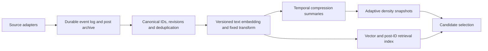

# Adaptive-tree compression for a day of activity

The new experiment compares **full retained-day replay, spatial histograms, microclusters, residual evidence at ancestors, and leaf-local online MPPCA**. Every backend accounts for every admitted observation whose time bucket remains active. The compressed backends have fixed summary budgets; the number of represented events can greatly exceed the number of summaries. The original 600-point cache is not used.

Open [the interactive comparison](../output/compression/demo.html). It includes playback, a time slider, source-colored new points, tree cuts, optional summary boxes, memory/error histories, source totals, and a hypothetical daily vector-storage calculator. [A static preview](../output/compression/preview.png) is also available.

```sh
julia --project=. examples/compression_demo.jl
# Optional: stream seed, base arrivals per quarter-hour, output directory
julia --project=. examples/compression_demo.jl 123 10000 output/compression-seed123

julia --project=. examples/compression_scaling.jl
julia --project=. test/runtests.jl
```

Only Julia standard libraries are required. The browser renders Julia-computed snapshots; changing the storage calculator does not rerun a model. Generated data, including CSVs, is under `output/compression/`.

## What is actually compared

A synthetic 36-hour sequence admits 294,400 events by default, with source labels Mastodon, Nostr, Bluesky, and Threads. The labels illustrate a shared stream with changing source contributions; they are not connectors or estimates of actual platform volume. The stream has moving clusters, a burst with duplicate coordinates, a new topic, quieter hours, and old-bucket expiry. All methods use identical observations, a six-hour decay half-life, unit-square coordinates, and at most 127 candidate tree nodes.

We run beyond a day to test expiry. The model retains **the current hour and the previous 23 hourly buckets**, not precisely the last 86,400 seconds. A bucket is removed at a boundary, so some events expire up to one hour early. This is a deliberate temporal approximation, shared across all methods. A single calendar day's bucket set is also representable; automatically archiving completed calendar days is not implemented.

A six-hour half-life answers “what is recently active within the retained day?” Exact unweighted retained-event counts are displayed separately. Setting `half_life=Inf` gives equal observation weights throughout the retained window. Decay and the retention horizon are separate settings.

### Algorithms and their actual update behavior

| Method | Per-event summary update | Historical evidence at a new cut | What is preserved | What is lost |
|---|---|---|---|---|
| Full-day replay | Append `(x, y, weight-at-bucket-origin)` | Route every retained point exactly | Coordinates and weighted spatial assignments for retained observations | Everything outside the window; this toy does not retain individual source IDs, post IDs or text |
| Spatial histogram | Increment one fixed 2D cell | Distribute bin mass according to overlap with each child | Exact bin weights, total evidence and source totals | Sub-bin detail; cuts crossing a bin require a uniform assumption |
| Microclusters | Find nearest centroid; add to it, or create a summary if distant and capacity remains | Distribute cluster mass uniformly across its bounding rectangle | Weighted mass, first/diagonal-second moments, conservative bounds and source totals | Individual coordinates and within-box density; broad boxes can cross empty space |
| Ancestor residuals | Route to the current leaf; add mass to its time-bucket slot | Keep old evidence at the parent; new arrivals go deeper | Evidence ownership, total mass and source totals; installing a split preserves density | The location of coarse history inside a cell; retrospective fine detail cannot be recovered |

The microcluster implementation is deliberately small: it uses an Euclidean nearest-centroid scan, a creation radius of 0.045, and at most 64 summaries per hour. When full, it absorbs the point into the nearest existing summary. It does **not** implement ClusTree, Gaussian leaves, adaptive cluster merging, or a coreset guarantee. It preserves pooled moments, but uses a **uniform conservative bounding box** for branch allocation. This avoids presenting centroid routing as exact historical allocation. The existing moments could support another within-box approximation in a future experiment.

The histogram is a full joint 16×16 grid, not independent per-coordinate marginals. Its mass allocation is exact for the chosen uniform-bin approximation, not for discarded point locations. A 16-bin-per-axis joint grid grows as `16^d`: this is a useful 2D reference, not a direct solution for hundreds of embedding dimensions.

Residual evidence is a separate mixture model:

```
density(x) = [κ + Σ ancestor_mass / ancestor_area] / [κ + total_mass]
```

Here `κ=2` is a root-uniform baseline on the unit square. Each observation has exactly one residual owner. A child's probability includes inherited ancestor density; its own stored mass alone is not the probability of its spatial region. This differs from the Beta branch priors used by the other three methods, so residual-versus-replay error combines compression, allocation-model, and maintenance-policy differences.

### Adaptive geometry

Replay, histogram, and microcluster summaries are refitted into the same seeded Mondrian scaffold at each maintenance tick. Internal cuts survive when their node's effective evidence is at least 60; other subtrees collapse. Refit pools or reassigns all current summary mass, then compacts active tree nodes.

Residual history keeps its existing supports. A leaf with at least 60 evidence units can open its next scaffold cut, keeping its history at that leaf's node. At most one level opens per path per maintenance tick. A subtree below 20 evidence units collapses and pools its time-bucket masses. The separated thresholds provide hysteresis. Pooling conserves evidence but generally changes density.

All four remain scaffold-based adaptive models. No backend learns new cut positions outside that scaffold. In particular, this experiment studies compression while holding candidate geometry stable; it does not yet implement flexible local split proposals. Dormant residual nodes retain preallocated slots, so collapse changes active resolution without reducing allocated residual storage. Reported memory includes these slots and both stored tree objects.

## The update function

The public interface is in [src/Compression.jl](../src/Compression.jl):

```julia
using MondrianPolyaToy

model = CompressionModel(:microclusters;
    half_life=6.0,             # hours
    bucket_hours=1.0,
    window_buckets=24,
    cluster_cap=64,
)

ingest!(model, (0.25, 0.72);
    source=1, event_time=10.2, now=10.3)

# Scheduled after a batch (every 15 simulated minutes in the demo).
maintain!(model; now=10.3)
compression_density(model, (0.25, 0.72))
compressed_mass(model)        # decayed evidence in active buckets
represented_count(model)     # unweighted event count in active buckets
source_mass(model)           # decayed totals by source
```

`ingest!` validates the event, expires old buckets, identifies its event-time bucket, increments exact source totals, and dispatches to the compressor. It does not keep a raw-point cache except in `:replay`. Late events are accepted if their bucket is still retained; future or expired events are rejected before mutation. IDs and revisions are not managed by this API.

Bucket weights are stored at their origin `b`:

```
stored contribution = base_weight × exp(β × (event_time - b))
current contribution = stored contribution × exp(-β × (now - b))
```

Multiplying those factors yields the intended exponential weight. This allows sums and moments to age without per-event sweeps over all existing summaries. All backends maintain exact unweighted source counts as well as weighted source totals; they do not preserve a separate spatial density per source.

`maintain!` expires buckets and publishes a current density. Replay/grid/microcluster models are rebuilt from summaries; the residual model performs local splits and pooling. Queries intentionally reject dirty models, preventing silent use of a stale tree after ingestion or clock advancement. A production implementation could publish immutable snapshots while a background worker prepares the next one; that concurrency is not implemented here.

With `B` time buckets, `K` microclusters per bucket, `G` grid cells per bucket, `N` candidate nodes, and tree depth `h`:

| Backend | Summary memory in 2D | Ingestion in this toy | Maintenance work |
|---|---|---|---|
| Replay | O(events in window) | O(B) expiry scan + amortized append | O(events × h), plus scaffold and compaction |
| Histogram | O(BG) | O(B) expiry scan + one bin | Up to O(BGN) for crossed rectangles |
| Microclusters | O(BK) | O(B + K) | Up to O(BKN) for crossed rectangles |
| Residual | O(BN) | O(B + h) | O(BN) mass materialization plus subtree traversal/pooling; repeated subtree totals can add O(Nh) |

These are accounting bounds for this implementation, not throughput guarantees. The expiry scan could run only when crossing a bucket boundary. Microcluster indexing, incremental refits, and tighter traversal are further optimizations. Full-day replay is retained as an offline reference, not proposed as the eventual live ingestion path.

## Results and what they mean

Default seed 42, 294,400 admissions, 145 snapshots, and one fixed scaffold seed:

| Backend | Peak reachable model MiB | Mean exact L1 vs replay ↓ | Mean held-out log density ↑ |
|---|---:|---:|---:|
| Full-day replay | 7.1249 | 0.0000 | 0.7053 |
| Histogram | 0.0752 | 0.0451 | 0.7035 |
| Microclusters | 0.1581 | 0.0711 | 0.7020 |
| Ancestor residuals | 0.0537 | 0.1423 | 0.6430 |

L1 is integrated over exact intersections of the two models' rectangular leaves, before display rounding. Its range is 0–2. It measures disagreement with replay, not error against an unknown true social distribution. Audit log density uses 80 independently sampled probes after each tick's update; it is **not** a pre-update score. Scores and L1 means exclude the empty initial frame.

In this stream, the histogram is both smaller and closer to replay than the current microcluster implementation. Residual history has a substantial startup resolution delay, visible in the error chart; it gets closer after prospective evidence fills descendants. This is one stream without uncertainty intervals, not a universal algorithm ranking. The summary budgets are deliberately explicit but **not byte-matched**: histogram has up to 6144 bins, microclusters up to 1536 moment summaries, and residuals 3048 evidence slots, plus common bookkeeping. The comparison is a starting point for a matched-memory sweep.

A separate uniform-stream memory check admits 10,000, 100,000, and **1,000,000** observations into the retained day. All events are represented by every backend:

| Admitted events | Replay bytes | Histogram bytes | Microcluster bytes | Residual bytes |
|---|---:|---:|---:|---:|
| 10,000 | 336,136 | 77,560 | 164,712 | 56,360 |
| 100,000 | 3,792,808 | 79,960 | 167,112 | 56,360 |
| 1,000,000 | 31,984,296 | 80,440 | 167,592 | 56,360 |

This confirms bounded summary state on this workload; it says nothing about real API ingestion or encoder throughput. Small histogram/microcluster memory changes come from tree size; replay's allocated vector capacity also affects its size. See [scaling.csv](../output/compression/scaling.csv).

All methods matched effective evidence exactly in the demo. Maximum normalization error was `5.55e-16`. The full test suite has 1,943 passing assertions, including weighted replay, moments, source totals, expiry, degenerate boxes, density-preserving residual splits, ancestor overlap, and post-collapse mass conservation. Browser checks cover playback, seeking, overlays, mobile layout, counts, and the storage calculator.

`Base.summarysize` measures reachable model objects, including scaffolds, summaries, and published trees. It excludes the raw text archive, retrieval index, encoding pipeline, offline animation snapshots, and temporary rebuild objects. CSV maintenance allocations count bytes allocated during a call, not peak live memory. Ingest and maintenance timings are illustrative local measurements after a small warmup; no real platform or production throughput claim follows from them.

## Implications for a social-media system

Compression removes the requirement to keep every embedding in the **live density model**. It does not remove the need to retain actual posts if “track the day” includes retrieval, provenance, edits, deletion, or reprocessing with another encoder.

A useful implementation boundary is:



Only the synthetic 2D summary/density portion is implemented here. Data access, archive storage, source adapters, encoder choice, content policy and indexing remain separate tasks. Source access may cover only a sampled or otherwise limited stream, so the density should describe **admitted events**, not claim coverage of an entire platform.

For a strict day-retention target, decide whether it means a calendar day or an exact trailing 24 hours. Five-minute buckets (`bucket_hours=1/12`, `window_buckets=288`) tighten expiry error to under five minutes but require twelve times as many temporal buckets at the same per-bucket summary budget. An archive can retain exact timestamps independently. A model with `half_life=Inf` describes total retained-day volume; another half-life can describe current activity.

The present source counters survive spatial compression, but compressed components do not preserve post IDs or enough provenance for arbitrary named removal. A real deletion/revision path therefore needs a contribution ledger, archive-based rebuild, or summaries organized to permit the required corrections. The toy counts duplicates and repeated revisions as separate admissions; the synthetic duplicate burst makes the resulting concentration visible.

For general embedding dimensions, microclusters and residual histories remain candidates whose state grows with dimensions and node/summary counts. The full 2D histogram does not. A possible next experiment is a residual tree with small local sketches supporting selected split questions, compared with microclusters under equal measured memory and multiple seeds. No claim of semantic quality follows from 2D synthetic density fidelity.

The browser's storage calculator uses hypothetical rates. For example, 1,000 admitted events/s is 86.4 million events/day. A 384-dimensional Float16 vector payload alone is 66.36 GB/day in decimal units, before text, IDs, indexes, replicas or runtime overhead. That arithmetic illustrates why the archive and live density budgets need separate accounting; it is not a platform traffic estimate.

## Relation to the notes and literature

The supplied design notes motivated time decay, explicit compression loss, retained replay, and residual ownership. These are implemented as exploratory alternatives, not treated as verified requirements.

[MOA's ClusKernel implementation](https://raw.githubusercontent.com/Waikato/moa/master/moa/src/main/java/moa/clusterers/clustree/ClusKernel.java) is precedent for aging weight, first moments and second moments together. [Ben-Haim and Tom-Tov's streaming tree paper](https://jmlr.org/beta/papers/v11/ben-haim10a.html) provides histogram-based streaming split context, but our fixed joint grid is not its algorithm. [Dynamic trees for streaming and massive data contexts](https://arxiv.org/abs/1201.5568) motivates retirement of individual observations; our residual density construction remains a separate experiment. None of those sources supplies guarantees for this combined prototype.


## Previous global-per-hour PPCA baseline

The comparison now includes `CompressionModel(:ppca)`. Each hourly bucket owns up to eight components (also limited by `cluster_cap`). Novel observations seed components until the budget fills; otherwise Gaussian likelihoods and component masses give soft responsibilities. Weighted Welford updates accumulate responsibility-weighted mass, means and full 2×2 covariance statistics online. Earlier responsibilities are not recomputed. This is an online soft-EM-style estimator with novelty initialization, not batch EM or an exact reproduction of a published online algorithm.

Each component is interpreted as rank-one PPCA: its dominant eigenvector supplies the loading direction, the smaller eigenvalue supplies isotropic noise, and loading magnitude is the square root of the eigenvalue gap. Positive variance floors stabilize likelihoods. In two dimensions this spans every positive-definite covariance; it does not demonstrate low-rank storage savings in 256 dimensions. Initialization and the fixed component budget affect results. There is no global EM convergence guarantee or automatic model selection.

For maintenance, 64 deterministic polar Gaussian quadrature nodes per component are generated. Nodes outside the unit square are discarded; remaining weights are renormalized, with a centroid fallback. They replay approximate component mass through the same scaffold and pruning rule as the other replay summaries. This approximates a bounded Gaussian component; fitting responsibilities still use untruncated Gaussian likelihoods. The final published density is the tree's piecewise-uniform Pólya density, not a directly evaluated Gaussian mixture. L1 compares these published trees exactly; quadrature error is included in PPCA's approximation error. Ellipses show current-hour two-standard-deviation contours, not hard component boundaries.

Hourly weights and expiry follow the existing shared contract. PPCA conserves total retained mass and global weighted first/second moments (up to roundoff), including the cross-coordinate moment that the old microclusters do not store. Priors/floors regularize fitted covariance without modifying those stored sufficient statistics.

Default 294,400-event run, seed 42:

| Method | Peak model MiB | Mean L1 vs replay ↓ | Mean held-out log density ↑ |
|---|---:|---:|---:|
| Replay | 7.1256 | 0 | 0.7053 |
| Histogram | 0.0759 | 0.0451 | 0.7035 |
| Microclusters | 0.1589 | 0.0711 | 0.7020 |
| Ancestor residuals | 0.0545 | 0.1423 | 0.6430 |
| Online PPCA | 0.0389 | 0.1075 | 0.6752 |

Budgets are not byte-matched: PPCA has only eight components/hour versus 64 microclusters/hour. This run supports a memory/fidelity tradeoff, not PPCA superiority. The existing scaling experiment remains the original four-method experiment unless explicitly extended.

This is a **summary comparison**, not the versioned per-vector latent codec discussed for embeddings. It stores no post-specific coordinates or residual codes, and does not modify the Bluesky or MNIST models. A high-dimensional codec still needs frozen decoder versions, quantization, reconstruction and retrieval tests. The full test suite includes soft-weight moment conservation, finite positive covariance, decay/late arrivals, expiry, density normalization and tree mass accounting for PPCA.


## Leaf-local MPPCA (current demo)

The fifth panel now uses `CompressionModel(:mppca)`. Each **tree region × hourly bucket** owns a separate mixture of up to eight rank-one PPCA components (also capped by `cluster_cap`). This replaces the previous eight components shared across the whole space per hour. `:ppca` remains available as the earlier global baseline, but is not the fifth panel anymore.

An observation traverses the prospective split mask on the fixed scaffold and updates only its current leaf's mixture in its event-time bucket. Within that mixture, assignment is soft and covariance statistics update online. At maintenance, a leaf activates its next scaffold split when its decayed local mixture mass reaches the split threshold. Growth is at most one level per path per maintenance. Historical mixtures stay at the ancestor, and future observations populate the new children. Late observations route using the current split mask. This avoids redistributing old component statistics by guessed membership.

For tree fitting, each mixture's deterministic Gaussian quadrature is restricted to its owning cell rather than just the unit square. Parent mixtures can contribute approximate mass to descendants; terminal owner mixtures preserve their region's mass exactly. The published density is still the pruned Pólya tree density. The prospective ownership mask grows monotonically within the finite scaffold; published density pruning is separate. Hourly expiry deletes mixtures, but this version does not coalesce the ownership mask after expiry. It is a local-mixture extension of this prototype, not a reproduction of MOUSSE or a published online MPPCA algorithm.

Updated same-stream comparison (294,400 arrivals, seed 42):

| Method | Peak model MiB | Mean L1 vs replay ↓ | Mean held-out log density ↑ |
|---|---:|---:|---:|
| Replay | 7.1273 | 0 | 0.7053 |
| Histogram | 0.0776 | 0.0451 | 0.7035 |
| Microclusters | 0.1606 | 0.0711 | 0.7020 |
| Ancestor residuals | 0.0562 | 0.1423 | 0.6430 |
| Leaf-local MPPCA | 0.4170 | 0.0131 | 0.7034 |

Mean L1 falls substantially relative to the former global PPCA baseline (0.1075), with higher memory and maintenance cost. The new allocation permits up to `127 × 8 × 24 = 24,384` components including historical ancestor owners; actual allocation is demand-driven. These budgets are not matched. Region ownership itself improves branch-mass fidelity, so this comparison cannot isolate the contribution of PPCA covariance modeling. An ownership-matched centroid or local-histogram baseline would be needed for that claim. No high-dimensional codec or per-post latent codes are implemented here.

The viewer lists both the number of components and the number of local mixtures. Ellipses include all current-hour owner mixtures, including ancestors. Tests check multi-region allocation, per-owner budgets, historical ancestor retention, support restriction, weighted global moments, mass, normalization and expiry. The original global PPCA tests remain in place.
