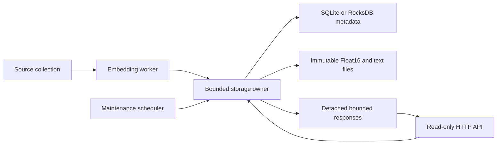

# Server implementation status

The server is implemented with selectable SQLite and RocksDB backends. The three public query endpoints are read-only;
combined mode also runs the existing ingestion pipeline. See [README.md](README.md)
for commands and [API.md](API.md) for the implemented contract.

## Decisions retained

- Julia HTTP.jl 2.7.1 with one bounded storage-owner queue.
- Approximate regional cosine top 25, default four leaves / 256 candidates.
- Combined canonical YAKE phrases and hashtags, counting each term once per post.
- Current pinned live encoder, Float16 storage, rank-4 PPCA and keyword policy.
- Compact partition density pack by default; optional untruncated PPCA moments.
- Persistent store UUID, embedding-space descriptor/hash and string-valued IDs.
- SQLite stays the default for new stores; RocksDB is explicitly selectable or auto-detected on reopen.
- See [RocksDB.md](RocksDB.md) for the native backend and explicit copy command.

## Completed

| Component | Implementation |
| --- | --- |
| Pure queries | Tree export, normalized partition weights, cosine reranking and offsets, pure term aggregation and pagination. |
| Concurrency | Bounded owner queue, request admission, body/reply bounds, expired queued-job rejection. |
| Ingestion | Source collection and embedding inference outside the owner; commit planning repeats against current state. |
| Maintenance | Scheduled logical expiry/merging, resumable daily vector/text reclamation and post-publication GC. |
| HTTP | Three endpoints, ETags/gzip tree packs, CORS, validation/error codes, health/readiness, bounded-duration CLI. |
| Compatibility | Load core modules at their existing Julia Serialization paths; preserve old stores and embedding spaces. |
| Tests | Geometry/normalization, offsets/ranking, terms, generation/RNG invariance, concurrent requests, preparation failure, overload, deadlines, restart, reclamation. |
| Pilot | Real 100k stored corpus, bounded live ingestion, metadata benchmark and integrated RocksDB validation. |
| RocksDB | Native records/indexes, bounded disk undo journal, recovery, backend parity and explicit SQLite copy. |

## Storage ownership

Native keyword preparation currently runs inside the owner before the write
transaction. This is an intentional first implementation boundary: the expensive
embedding model and network waits stay outside, while extraction and source-state
validation reuse the tested commit path. The owner uses FIFO scheduling, not a
priority scheduler. Long splits, expiry/rebuild transactions or preparation can
still delay reads. A caller timing out never interrupts a transaction halfway.

Queries do not run expiry or write persistent statistics. Aggregate reads reject
overdue expiry; nearby filters hard-expired rows. The owner protects external files
until response data has been detached, so reclamation cannot race those readers.
Independent reader connections would require explicit payload-file leases; RocksDB readers would also need a visibility protocol for staged journaled updates.

Daily reclamation publishes one vector frame (at most 256 rows), 128 text records,
or 32 garbage-file removals per job. Progress is persisted; restart resumes it.
Entirely live vector files are skipped. Source updates between pages remain safe;
new garbage behind the cursor can wait for the next daily pass.

## Measured scope and remaining work

The pilot and database ablation are described in [benchmark/RESULTS.md](benchmark/RESULTS.md).
The database experiment shares keys, values, durable batches and read fixtures;
it remains a metadata-only benchmark. The integrated backend now has separate
source replay, keyword lifecycle, crash, reclamation and cross-backend parity tests;
see [benchmark/RocksDB_Results.md](benchmark/RocksDB_Results.md).

Remaining work is performance/scaling and deployment, not another wire-contract
redesign:

- Measure mixed-client load with sustained ingestion, logical expiry and large
  split/merge transactions; the current pilot is not a latency SLO.
- Cache/version bounded top-term pages or maintain an appropriate summary index;
  current pagination scans aggregate rows and bounds output/memory only.
- Compare larger caches and leaf-oriented payload placement for nearby queries.
  Faster metadata alone does not remove scattered vector reads.
- Add PPCA pack chunking or per-region requests when a complete optional pack
  exceeds the configured response allowance.
- Tune RocksDB record encoding, metadata compression and the publication protocol
  against sustained mixed workloads; do not extrapolate the old microbenchmark.
- Configure public hostname/TLS, allowed browser origins and deployment quotas
  when choosing a host. The supplied configuration binds locally.

Feedback storage, server-side recommendation policy, on-demand embeddings,
precomputed Fermat paths, cross-encoder queries and global exact kNN remain outside
this server. Clients choose their distance regularization, path approximation and
recommendation algorithms from the published density and candidate data.
